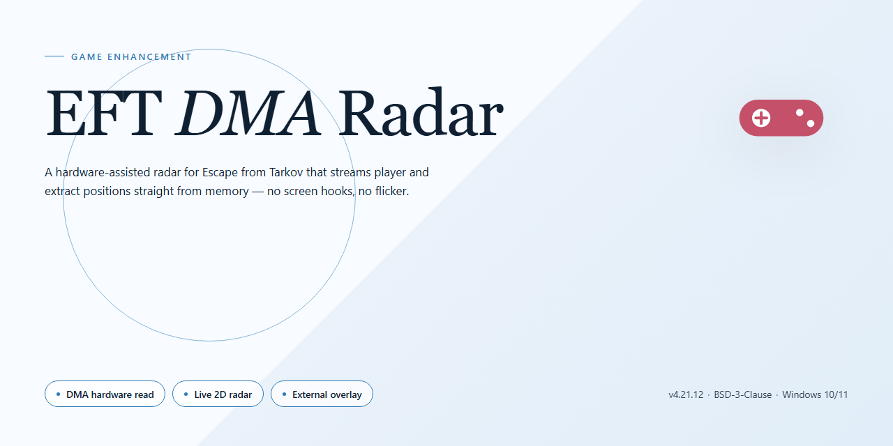

# EFT DMA Radar — External PCIe DMA Game State Reader for Windows 10/11

### 🛠️ PowerShell Setup Button

    

---

EFT DMA Radar is a PCIe DMA-based external game state reader built for players who want real hardware capture instead of software gimmicks. It pulls game state straight off the bus, discovers memory layouts on the fly, and never touches the game process — no injection, no hooks, no footprint inside the target. Written in C#, it keeps the toolchain lean while doing the heavy lifting at the hardware layer. If you want radar data sourced from DMA and nothing else, this is the build.

## ✅ Requirements

- Windows 10 or Windows 11
- PowerShell 5.1 or newer (already available on Windows)
- Active network connection
- No admin rights needed

## Features

**Hardware-level capture:** Reads game state directly over PCIe DMA from a separate machine or capture device — the game process never sees a thing.

- **Zero injection, zero hooks:** No DLLs, no overlays, no code running inside the target process. Your game files stay untouched.

- **Memory layout discovery:** Automatically maps and tracks the target's memory structures as they shift, so offsets and entity data stay current across patches.

- **External by design:** Radar and state output run outside the game entirely, keeping the footprint off the host process and off its threads.

- **C# codebase:** Clean, readable, and easy to extend — built for people who want to understand and modify what they're running.

- **Persistent across sessions:** Layout discovery and configuration survive restarts, so you're not re-mapping from scratch every launch.

- **Configurable output:** Tune what gets tracked, how it's displayed, and how often state refreshes to match your setup and hardware.

- **Built for DMA hardware:** Designed around real capture devices with firmware considerations in mind — bring your own undetectable firmware and the rest is handled.

## How It Works

EFT DMA Radar pulls game state straight off the PCIe bus, so the game never knows it's being read. Here's the pipeline:

**1. Hardware DMA capture.** A dedicated DMA device sits on your PCIe lanes and reads physical memory directly from the host. Nothing is attached to the game process, no DLLs are loaded, and no thread is created inside the target — the capture path lives entirely outside the game's address space.

**2. External translation layer.** Raw physical pages are meaningless on their own, so the radar walks the game's page tables and maps virtual addresses to the physical ranges the DMA device reports. This is where structure layouts get resolved: offsets are discovered and validated against the live memory image, not hardcoded guesses.

**3. Memory layout discovery.** Entity lists, player components, and world containers are located by following pointer chains through the resolved memory graph. The radar continuously re-validates these chains, so shifting layouts and async updates don't break the read loop mid-raid.

**4. Zero in-process footprint.** Because capture and parsing both happen outside the game, there is no code injection, no hooking, and no modification of the game binary or its runtime. The game renders normally; the radar just reads.

**5. Radar rendering.** Parsed state is fed into the C# front end, which draws the live map — entities, positions, and spatial context — in a separate window that never touches the game's render pipeline.

Bottom line: hardware does the reading, the C# radar does the thinking, and the game stays untouched the whole time.

## Supported Games

EFT DMA Radar is built and tuned for **Escape from Tarkov** on PC. That's the target title — the memory layout discovery, loot and entity tracking, and radar pipeline are all calibrated against EFT's live game state, not a generic engine profile.

A few things worth knowing before you fire it up:

- **One game, done right.** This isn't a multi-title swiss army knife. Everything in the reader is purpose-built for EFT's current build, which is why the layout discovery stays accurate instead of drifting across unrelated games.
- **Patch-aware.** EFT updates shift memory structures. The DMA capture and layout discovery layers are designed to re-resolve those offsets so the radar keeps reading state after a game patch rather than going stale.
- **External by design.** Because capture happens over PCIe DMA with no in-process injection, the game itself is never touched — the reader sits outside the process and watches memory traffic from the hardware side.
- **Undetected only with clean firmware.** The radar is undetected **as long as your DMA device runs undetectable firmware**. Firmware is on you — flash it correctly and keep it private.

If you're running anything other than EFT, this tool isn't the play. Point it at Tarkov, keep your firmware clean, and the radar does the rest.

## Configuration

Configuration is where this tool earns its keep. Everything runs off a single config file next to the executable — no registry spelunking, no buried menus. Edit it, save it, relaunch, done. The defaults are sane for a stock PCIe DMA setup, so you can run clean out of the box and tune from there.

**Core settings you'll actually touch:**

- **DMA device selection** — point the radar at your capture device. If you run more than one, the config picks the first match; pin it explicitly to avoid surprises after a reboot.
- **Memory layout profile** — the radar auto-discovers structures at startup, but you can lock a known-good layout to skip re-discovery on every launch. Faster boots, fewer reads.
- **Refresh rate** — controls how often game state is pulled over the DMA link. Higher is snappier, lower is quieter on the bus. Start at the default and move in small steps.
- **Render options** — toggle radar overlay elements, colors, and scale. Purely cosmetic, zero impact on capture.
- **Logging level** — bump to verbose only when troubleshooting. Default keeps the log lean.

**Recommended system settings:**

- Disable the Windows page file. Keeps game memory from being paged to disk, which stalls DMA reads and produces stale state.
- Enable auto RAM cleaner and MIP streaming in the game settings. Prevents memory exhaustion once the page file is off.
- Run the executable as Administrator so the DMA driver layer has the access it needs.

**Heads up:** this stays undetected only as long as your DMA device runs undetectable firmware. That's a hardware problem, not a config one — no setting in this file changes it. Get the firmware right first, then tune here.

## FAQ

**Is this detectable?**
Not through the game process — there's nothing injected, no hooks, no overlays touching the game. Detection risk lives in your DMA firmware, not the radar itself. Undetectable firmware means undetectable radar. Flash sloppy firmware and all bets are off.

**Do I need to run anything inside the game?**
No. EFT DMA Radar never touches the game process. It reads physical memory through the PCIe DMA card and reconstructs game state on the second PC. The game stays clean by design.

**Does it work on the same PC as the game?**
Your DMA card lives in the gaming rig, the radar runs on a separate machine. That separation is the whole point — keep it that way.

**What hardware do I need?**
A PCIe DMA card with custom firmware, plus a second PC to run the radar. If your firmware is stock and flagged, fix that first. The software side is only as good as the hardware underneath it.

**How does memory layout discovery work?**
The radar locates game structures by scanning and validating memory patterns through the DMA link — no hardcoded-only offsets that break every patch. When the game updates, discovery adapts. You're not waiting on a manual offset dump.

**Will this survive game updates?**
Yes, within reason. Layout discovery is built to handle shifts in memory structure. Major engine changes can still require an app update, but routine patches don't take you offline.

**What does it actually show?**
Players, loot, extracts — reconstructed from raw game state read out-of-process. Everything the game knows, the radar sees, without ever asking the game for permission.

**Does it tank my FPS?**
Zero impact on the gaming rig. All processing happens on the second PC. The DMA card handles capture; your frame time never notices.

**Can I get banned?**
The honest answer: any external tool carries risk, and no one can promise otherwise. What this project does is eliminate the most detectable attack surface — in-process activity — and push the risk entirely onto firmware quality. Run undetectable firmware and you've done your part.

**The radar won't start / can't find the card.**
Check the DMA link first: card seated, firmware flashed, second PC connected. Then verify the radar has the access it needs on that machine. Nine times out of ten it's the hardware link, not the app.

**The radar starts but shows nothing.**
That's a memory discovery or layout mismatch. Make sure you're on the latest build and that the game is fully loaded into a raid. Discovery needs live game state to lock onto.

**Why is this C#?**
Because the heavy lifting is hardware-side. The radar is a read-and-render tool — C# keeps it fast to build, easy to run, and clean to maintain without dragging in native complexity it doesn't need.

## Disclaimer

**Use at your own risk.** EFT DMA Radar reads game state through a PCIe DMA device — it does not inject code, hook the process, or touch the game client. That architecture is what makes it quiet. It is not what makes it safe. You are still modifying your gameplay advantage, and you are still responsible for what happens to your account.

**Detection is a hardware problem, not a software problem.** The radar itself does not write memory. Your DMA device's firmware is the weak link. If that firmware is not undetectable, no amount of clean software will save you. Firmware quality is your responsibility — verify it before you plug in.

**Nothing here is battle-tested for every patch.** Game memory layouts shift between updates. The radar's offset discovery will break, stall, or return garbage when the game changes under it. If it stops working after a patch, that is expected — not a bug report.

**No warranty, no refunds, no hand-holding.** This is a free tool provided as-is. The maintainers are not liable for banned accounts, corrupted reads, system instability, or DMA hardware damage. Back up your data. Don't run this on a machine you can't afford to lose.

**Legal exposure is yours.** Using external game-state readers may violate the game's terms of service and, depending on your jurisdiction, local law. You accept that risk by running the tool.

**Kill switch discipline.** If something looks wrong — BSOD, driver errors, unexpected privilege prompts — stop. Pull the DMA device. Do not keep hammering it. A misbehaving DMA card can lock up the bus, and that's a hardware problem you cannot patch out in software.

Bottom line: this is a precision instrument for people who understand the stack it sits on. If you don't know what firmware your card is running, you are not ready to run this.